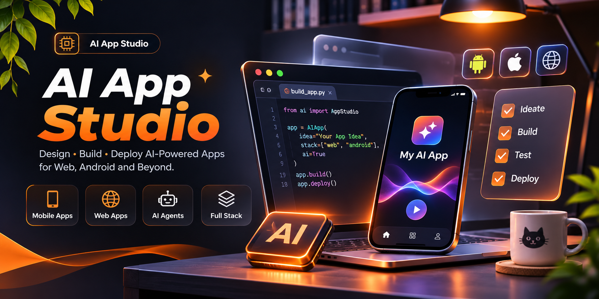
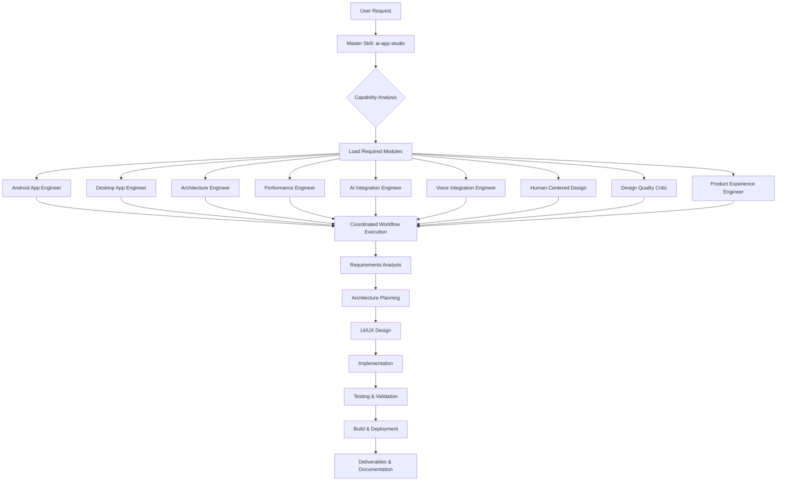

<div align="center">

    

**Professional AI-powered application development workflow for Android and desktop platforms**

[Quick Start](#quick-start) • [Architecture](#master-skill-architecture) • [Capabilities](#what-can-you-build) • [Installation](#installation) • [Documentation](#documentation-and-resources)

</div>

---

## Table of Contents

- [About AI App Studio](#about-ai-app-studio)
- [Project Overview and Statistics](#project-overview-and-statistics)
- [What Can You Build?](#what-can-you-build)
- [Master Skill Architecture](#master-skill-architecture)
- [Internal Specialist Modules](#internal-specialist-modules)
- [Application Development Workflow](#application-development-workflow)
- [Android Development](#android-development)
- [Desktop Application Development](#desktop-application-development)
- [Mobile Application Development](#mobile-application-development)
- [AI-Powered Applications](#ai-powered-applications)
- [Human-Centered Product Design](#human-centered-product-design)
- [UI/UX and Design Quality Review](#uiux-and-design-quality-review)
- [Quick Start](#quick-start)
- [Installation](#installation)
- [Technology Stack and Frameworks](#technology-stack-and-frameworks)
- [Architecture and Project Structure](#architecture-and-project-structure)
- [API, Backend and Database Integration](#api-backend-and-database-integration)
- [Voice and AI Integration](#voice-and-ai-integration)
- [Testing and Quality Assurance](#testing-and-quality-assurance)
- [Security and Performance](#security-and-performance)
- [Build and Deployment Guide](#build-and-deployment-guide)
- [Output Structure and Deliverables](#output-structure-and-deliverables)
- [Troubleshooting and FAQ](#troubleshooting-and-faq)
- [Documentation and Resources](#documentation-and-resources)

---

## About AI App Studio

AI App Studio is a comprehensive master skill system designed to coordinate end-to-end application development workflows through AI-powered coding agents. Built for Claude Code and OpenCode, it provides a unified entry point that automatically orchestrates specialized internal modules to deliver production-ready Android and desktop applications.

Unlike traditional development frameworks that require manual module selection, AI App Studio operates through a single discoverable skill that intelligently loads relevant specialist playbooks as needed. This approach eliminates workflow fragmentation while maintaining deep expertise across mobile architecture, performance optimization, AI integration, and human-centered design.

The system emphasizes maintainable code, polished user experience, appropriate architecture patterns, reliable device integration, and verified builds. Every component is designed to avoid generic AI-generated interfaces through deliberate attention to typography, spacing, visual hierarchy, accessibility, and platform-consistent interactions.

**Core Principles:**

- **Single Entry Point:** One master skill coordinates all specialist modules automatically
- **Human-Centered Design:** Built-in quality gates prevent generic AI templates
- **Production Ready:** Verified builds, security checks, and deployment guidance
- **Platform Native:** Android and desktop development with proper lifecycle handling
- **AI Integration:** Voice assistants, LLM APIs, and intelligent features
- **Quality First:** Automated testing, performance optimization, and accessibility compliance

---

## Project Overview and Statistics

| Metric | Value |
|--------|-------|
| **Master Skills** | 1 |
| **Internal Specialist Modules** | 9 |
| **Human-Centered Design Modules** | 3 |
| **Supported Platforms** | Android, Desktop (Cross-platform) |
| **Development Workflows** | Requirements → Design → Build → Test → Deploy |
| **Primary Agent Compatibility** | Claude Code, OpenCode |
| **Architecture Patterns** | MVVM, Clean Architecture, Repository Pattern |
| **Integration Capabilities** | AI, Voice, Backend APIs, Databases, Authentication |

---

## What Can You Build?

AI App Studio supports comprehensive application development across multiple platforms and domains:

### **Android Applications**
- Native Android apps with Kotlin or Java
- Material Design 3 UI components
- Jetpack Compose modern UI toolkit
- Android Architecture Components (ViewModel, LiveData, Room)
- Background services and WorkManager tasks
- Device sensors and hardware integration
- Camera, location, and notification features
- Offline-first architecture with local persistence

### **Desktop Applications**
- Cross-platform desktop applications
- Native window management and system integration
- File system operations and local storage
- Desktop UI frameworks and component libraries
- System tray and notification integration
- Multi-window and multi-threaded architectures

### **Mobile UI Development**
- Responsive layouts for multiple screen sizes
- Adaptive interfaces for tablets and foldables
- Custom animations and transitions
- Platform-consistent navigation patterns
- Accessibility-compliant interfaces (WCAG standards)
- Dark mode and dynamic theming
- Loading states, empty states, and error handling

### **AI-Powered Applications**
- Large language model (LLM) integration
- Natural language processing features
- AI-generated content and recommendations
- Conversational interfaces and chatbots
- Context-aware intelligent assistants
- Machine learning model deployment

### **Voice-Enabled Applications**
- Voice assistant integration
- Speech-to-text and text-to-speech
- Voice command recognition
- Hands-free interaction modes
- Voice-driven navigation

### **Enterprise Features**
- RESTful API integration
- GraphQL client implementation
- Real-time data synchronization
- Authentication and authorization (OAuth 2.0, JWT)
- Role-based access control
- Secure credential storage
- Database integration (SQLite, Room, remote databases)
- Cloud backend connectivity

---

## Master Skill Architecture

AI App Studio exposes **one discoverable master skill** that coordinates all development workflows:

```
ai-app-studio
```

When you invoke this skill, it automatically:

1. **Analyzes your request** to determine required capabilities
2. **Loads relevant specialist modules** from internal references
3. **Coordinates the workflow** across design, architecture, implementation, and testing
4. **Delivers production artifacts** with validation results and deployment guidance

**You do not need to select individual modules manually.** The master skill intelligently orchestrates the appropriate specialists based on your project requirements.

### **How It Works**



### **Operating Protocol**

The master skill follows a rigorous workflow:

1. **Inspect** existing repository, project structure, and conventions
2. **Translate** request into deliverables, assumptions, and acceptance criteria
3. **Plan** phased implementation starting with working vertical slice
4. **Load** only relevant internal specialist references
5. **Discover** available tools, dependencies, APIs, and runtime capabilities
6. **Implement** within existing project while preserving working behavior
7. **Validate** with automated and manual checks, fixing issues found
8. **Report** exact changes, test results, deliverables, and unresolved issues

---

## Internal Specialist Modules

The master skill coordinates **9 internal specialist modules** that are loaded automatically as needed:

| Module | Category | Purpose |
|--------|----------|---------|
| **android-app-engineer** | Platform | Android application development with Kotlin/Java, Jetpack, and Material Design |
| **desktop-app-engineer** | Platform | Cross-platform desktop application development and system integration |
| **android-architecture-engineer** | Architecture | MVVM, Clean Architecture, dependency injection, and lifecycle management |
| **android-performance-engineer** | Optimization | Performance profiling, memory optimization, battery efficiency, and startup time |
| **android-ai-app-engineer** | Integration | AI/ML model integration, LLM APIs, and intelligent feature implementation |
| **android-voice-engineer** | Integration | Voice assistant integration, speech recognition, and voice command handling |
| **human-centered-product-design** | Design | Product identity, typography, spacing, visual hierarchy, and user-centered design |
| **design-quality-critic** | Quality | Design review, interface critique, and prevention of generic AI templates |
| **product-experience-engineer** | Experience | Navigation patterns, animations, accessibility, responsive design, and UX polish |

### **Human-Centered Design Modules**

Three specialized modules ensure applications avoid generic AI-generated interfaces:

- **human-centered-product-design:** Establishes unique product identity, professional typography, consistent spacing, and thoughtful visual hierarchy
- **design-quality-critic:** Reviews interfaces against quality standards, identifying generic patterns and suggesting improvements
- **product-experience-engineer:** Implements natural navigation, purposeful animations, responsive layouts, accessibility compliance, and consistent user experience

These modules are loaded automatically for any user-facing interface work and serve as quality gates throughout development—not as a last-minute decoration pass.

---

## Application Development Workflow


### **Phase-by-Phase Breakdown**

#### **1. Requirements Analysis**
- Translate user brief into user journeys and acceptance criteria
- Identify target platforms, devices, and OS versions
- Determine offline requirements and network dependencies
- Define permissions, privacy requirements, and data handling
- Establish non-functional requirements (performance, security, accessibility)

#### **2. Application Architecture**
- Select appropriate architecture pattern (MVVM, Clean Architecture, Repository)
- Design data flow and state management
- Plan persistence strategy (local database, file storage, cache)
- Define dependency injection structure
- Establish lifecycle handling and background work patterns

#### **3. UI/UX Design**
- Create navigation structure and information architecture
- Design visual states (loading, success, error, empty)
- Establish typography, colors, spacing, and component system
- Plan accessibility features and screen reader support
- Design platform-consistent interactions and gestures

#### **4. Frontend Development**
- Implement UI components and screens
- Build navigation and routing logic
- Integrate animations and transitions
- Handle user input and validation
- Implement responsive layouts

#### **5. Backend Integration**
- Connect to REST or GraphQL APIs
- Implement request/response handling
- Add error handling and retry logic
- Integrate real-time data synchronization
- Configure API authentication

#### **6. Database & APIs**
- Set up local database (Room, SQLite)
- Define data models and migrations
- Implement repository pattern
- Add caching and offline support
- Integrate third-party service APIs

#### **7. Authentication**
- Implement user authentication flow
- Add OAuth 2.0 or JWT token handling
- Store credentials securely (Keystore, encrypted storage)
- Handle session management and refresh tokens
- Implement role-based access control

#### **8. Testing & Debugging**
- Write unit tests for business logic
- Create UI tests for critical flows
- Perform device testing across screen sizes
- Debug crashes and performance issues
- Validate accessibility compliance

#### **9. Quality Review**
- Run human-centered design quality gates
- Review against design system consistency
- Verify performance benchmarks
- Check security and privacy compliance
- Validate error handling and edge cases

#### **10. Build & Deployment**
- Generate signed release builds
- Configure ProGuard/R8 optimization
- Prepare Play Store or distribution assets
- Create deployment documentation
- Document release checklist

---

## Android Development

AI App Studio provides comprehensive Android development capabilities with modern tooling and best practices.

### **Supported Technologies**

- **Languages:** Kotlin (primary), Java
- **UI Frameworks:** Jetpack Compose, XML Views, Material Design 3
- **Architecture:** Android Architecture Components, ViewModel, LiveData, DataBinding
- **Persistence:** Room Database, SQLite, DataStore, SharedPreferences
- **Networking:** Retrofit, OkHttp, Ktor Client
- **Dependency Injection:** Hilt, Dagger, Koin
- **Image Loading:** Coil, Glide, Picasso
- **Background Work:** WorkManager, Coroutines, Services
- **Testing:** JUnit, Espresso, Compose UI Testing, Mockito

### **Android-Specific Features**

- Material Design 3 theming and dynamic color
- Jetpack Compose modern declarative UI
- Android 14+ compatibility and latest API features
- Adaptive layouts for tablets and foldables
- Background services and scheduled tasks
- Device sensors (accelerometer, GPS, camera)
- Push notifications and Firebase Cloud Messaging
- Local and remote data synchronization
- Content providers and file access
- Android Keystore secure credential storage

### **Performance Optimization**

The `android-performance-engineer` module handles:

- App startup time optimization
- Memory leak detection and prevention
- Battery efficiency and power management
- Network request optimization and caching
- Image loading and bitmap management
- RecyclerView performance tuning
- ProGuard/R8 code optimization and shrinking
- Build time reduction strategies

---

## Desktop Application Development

Build cross-platform desktop applications with native system integration and modern UI frameworks.

### **Supported Frameworks**

- **Electron:** Cross-platform desktop apps with web technologies (HTML, CSS, JavaScript/TypeScript)
- **JavaFX:** Rich desktop applications with Java/Kotlin
- **.NET MAUI / WPF:** Windows desktop applications with C#
- **Qt:** Native performance with C++ or Python bindings
- **Tauri:** Lightweight Rust-based desktop apps

### **Desktop Application Features**

- Native window management and system tray integration
- File system access and local storage
- System notifications and native dialogs
- Multi-window and multi-threaded architectures
- Auto-update mechanisms
- Installer and package creation
- Cross-platform deployment (Windows, macOS, Linux)
- Native menu bars and keyboard shortcuts
- System integration (clipboard, file associations)

---

## Mobile Application Development

Comprehensive mobile UI development with responsive design and platform-consistent interactions.

### **UI Components**

- Navigation patterns (bottom nav, tabs, drawer, stack navigation)
- Form inputs with validation and error states
- Lists and grids with infinite scroll and pull-to-refresh
- Modals, bottom sheets, and dialogs
- Search interfaces with filtering and sorting
- Media players and image galleries
- Charts and data visualizations
- Custom animations and transitions

### **Responsive Design**

- Adaptive layouts for phones, tablets, and foldables
- Orientation handling (portrait/landscape)
- Multiple screen density support (ldpi to xxxhdpi)
- Flexible typography and spacing systems
- Responsive images and assets
- Accessibility features (font scaling, screen readers)
- Dark mode and theme switching
- Gesture handling and touch interactions

---

## AI-Powered Applications

Integrate artificial intelligence capabilities into your applications with modern LLM APIs and ML models.

### **AI Integration Capabilities**

- **LLM Integration:** OpenAI, Anthropic Claude, Google Gemini, local models
- **Natural Language Processing:** Text generation, summarization, sentiment analysis
- **Conversational AI:** Chatbots, virtual assistants, context-aware dialogs
- **Content Generation:** AI-written text, code generation, creative content
- **Recommendations:** Personalized suggestions based on user behavior
- **Classification:** Text categorization, intent detection, entity recognition

### **Implementation Patterns**

- Streaming responses for long-form AI generation
- Context management and conversation history
- Prompt engineering and template systems
- Error handling for API failures and rate limits
- Cost optimization and token management
- Caching and response deduplication
- Privacy-aware AI features (local processing where possible)

### **Requirements**

AI features require:
- Valid API keys for chosen providers (OpenAI, Anthropic, etc.)
- Network connectivity for cloud-based models
- User consent for data processing
- Rate limit handling and quota management
- Secure credential storage (never commit API keys)

---

## Voice and AI Integration

Enable voice-driven interactions and speech-based interfaces in your applications.

### **Voice Capabilities**

- **Speech-to-Text:** Convert spoken audio to text (Google Speech, Azure, local models)
- **Text-to-Speech:** Generate natural-sounding voice output
- **Voice Commands:** Recognize and execute voice-triggered actions
- **Voice Assistants:** Integrate with Siri, Google Assistant, Alexa
- **Hands-Free Modes:** Enable fully voice-driven navigation
- **Multilingual Support:** Handle multiple languages and accents

### **Voice Integration Patterns**

- Microphone permission handling
- Audio recording and streaming
- Real-time transcription display
- Voice activity detection
- Background audio processing
- Voice feedback and confirmation

### **Requirements**

Voice features require:
- Microphone permissions
- Audio recording capabilities
- Network access for cloud-based services (or local model deployment)
- Handling of noisy environments and audio quality issues

---

## Human-Centered Product Design

AI App Studio includes built-in human-centered design modules that prevent generic AI-generated interfaces and ensure professional, distinctive applications.

### **Design Principles**

- **Unique Product Identity:** Distinctive visual language that fits the product domain
- **Professional Typography:** Thoughtful font choices, hierarchy, and readability
- **Consistent Spacing:** Coherent spacing system across all UI elements
- **Visual Hierarchy:** Clear information architecture and emphasis
- **Natural Navigation:** Intuitive user flows and predictable interactions
- **Purposeful Animations:** Motion that guides attention and provides feedback
- **Responsive Interfaces:** Adaptive layouts for all screen sizes
- **Accessibility:** WCAG compliance, screen reader support, keyboard navigation
- **Realistic States:** Proper loading, empty, and error state designs
- **Consistent Experience:** Unified patterns across the entire application

### **Quality Gates**

The design modules serve as quality checkpoints throughout development:

1. **Initial Design Review:** Evaluate proposed interface against generic AI patterns
2. **Component Review:** Assess individual UI components for quality and consistency
3. **Interaction Review:** Verify navigation, animations, and user flows
4. **Accessibility Audit:** Check compliance with accessibility standards
5. **Final Quality Pass:** Comprehensive review before release

### **Avoiding Generic AI Templates**

The system actively prevents:
- Copy-paste Material Design without customization
- Default framework styling without brand identity
- Generic color schemes and typography
- Inconsistent spacing and alignment
- Missing or poorly designed empty states
- Generic placeholder content
- Inaccessible color contrast
- Inconsistent component behavior

**Note:** Design quality requires evaluation against specific criteria. The modules provide guidance and review, but achieving professional design is an iterative process.

---

## UI/UX and Design Quality Review

The `design-quality-critic` module provides systematic interface review and improvement recommendations.

### **Review Criteria**

- **Visual Design:** Typography, color, spacing, alignment, visual weight
- **Interaction Design:** Navigation clarity, feedback, error prevention, affordances
- **Information Architecture:** Content organization, labeling, hierarchy
- **Accessibility:** Color contrast, font scaling, screen reader support, keyboard access
- **Consistency:** Component reuse, pattern adherence, design system compliance
- **Responsive Design:** Adaptation across screen sizes, orientation handling
- **Performance:** Loading states, perceived performance, smooth animations
- **Platform Consistency:** Following platform conventions (Material, iOS, Windows)

### **Quality Review Process**

1. Analyze current interface implementation
2. Identify deviations from design principles
3. Compare against platform guidelines
4. Assess accessibility compliance
5. Provide specific improvement recommendations
6. Suggest alternative approaches with rationale

---

## Quick Start

### **For Claude Code**

```text
/ai-app-studio
```

Type the slash command in your Claude Code session to invoke the master skill.

### **For OpenCode**

```text
@ai-app-studio
```

Use the @ mention to activate the skill in OpenCode.

### **Example Prompts**

```text
/ai-app-studio Create an Android weather app with location tracking and 5-day forecast
```

```text
/ai-app-studio Build a desktop note-taking app with local storage and markdown support
```

```text
/ai-app-studio Add AI chat integration to my existing Android app
```

---

## Installation

### **Project-Level Installation (Recommended)**

Copy the skill into your target project:

```bash
# From the ai-app-studio repository root
cp -r .claude/skills/ai-app-studio /path/to/your/project/.claude/skills/
```

This makes the skill available within that specific project.

### **Global Installation**

For system-wide availability across all projects:

#### **Claude Code**

Place the skill folder in Claude Code's global skills directory:

```bash
# macOS/Linux
cp -r .claude/skills/ai-app-studio ~/.claude/skills/

# Windows
cp -r .claude/skills/ai-app-studio %USERPROFILE%\.claude\skills\
```

#### **OpenCode**

Follow OpenCode's skill installation documentation for global skills.

### **Verification**

After installation, verify the skill is discoverable:

**Claude Code:**
```text
/skills
```

**OpenCode:**
Check the available skills in your agent configuration.

The skill should appear as `ai-app-studio` in the list.

### **Updating**

To update the skill:

1. Pull the latest changes from this repository
2. Copy the updated `.claude/skills/ai-app-studio/` folder to replace the existing installation
3. Restart your AI agent if required

---

## Technology Stack and Frameworks

AI App Studio supports a comprehensive range of technologies across platforms:

### **Android**

| Category | Technologies |
|----------|-------------|
| **Languages** | Kotlin, Java |
| **UI Frameworks** | Jetpack Compose, XML Views, Material Design 3 |
| **Architecture** | MVVM, Clean Architecture, MVI, Repository Pattern |
| **Dependency Injection** | Hilt, Dagger 2, Koin |
| **Networking** | Retrofit, OkHttp, Ktor Client, Apollo GraphQL |
| **Database** | Room, SQLite, Realm, DataStore |
| **Async** | Kotlin Coroutines, RxJava, Flow |
| **Image Loading** | Coil, Glide, Picasso |
| **Testing** | JUnit, Espresso, Compose Test, MockK, Robolectric |

### **Desktop**

| Category | Technologies |
|----------|-------------|
| **Frameworks** | Electron, JavaFX, .NET MAUI, Qt, Tauri |
| **Languages** | JavaScript/TypeScript, Java/Kotlin, C#, Python, Rust |
| **UI** | React, Vue, Angular, JavaFX, WPF, Qt Widgets |
| **Build Tools** | Electron Builder, Gradle, MSBuild, CMake, Cargo |

### **Backend & APIs**

| Category | Technologies |
|----------|-------------|
| **API Clients** | Retrofit, Ktor, Axios, Fetch API |
| **Authentication** | OAuth 2.0, JWT, Firebase Auth, Auth0 |
| **Real-time** | WebSockets, Server-Sent Events, Firebase Realtime |
| **State Management** | Redux, MobX, Vuex, StateFlow |

### **AI & ML**

| Category | Technologies |
|----------|-------------|
| **LLM APIs** | OpenAI GPT, Anthropic Claude, Google Gemini |
| **ML Frameworks** | TensorFlow Lite, ML Kit, ONNX Runtime |
| **Voice** | Google Speech, Azure Speech, Whisper, Vosk |

---

## Architecture and Project Structure

AI App Studio follows modern architecture patterns and clean code organization.

### **Recommended Architecture Patterns**

#### **MVVM (Model-View-ViewModel)**
```
app/
├── data/           # Models, repositories, data sources
├── domain/         # Use cases, business logic
├── ui/             # Views, ViewModels, UI logic
└── di/             # Dependency injection modules
```

#### **Clean Architecture**
```
app/
├── data/           # Data layer (repositories, APIs, database)
├── domain/         # Domain layer (entities, use cases, interfaces)
├── presentation/   # Presentation layer (UI, ViewModels)
└── di/             # Dependency injection
```

### **Module Organization**

```
android-project/
├── app/                          # Main application module
├── core/                         # Shared core utilities
│   ├── network/                  # Networking components
│   ├── database/                 # Database configuration
│   └── utils/                    # Utility classes
├── feature/                      # Feature modules
│   ├── auth/                     # Authentication feature
│   ├── home/                     # Home screen feature
│   └── profile/                  # Profile feature
├── design/                       # Design system module
│   ├── theme/                    # Colors, typography, shapes
│   └── components/               # Reusable UI components
└── gradle/                       # Build configuration
```

### **Dependency Management**

- Use version catalogs (Gradle 7.0+) for centralized dependency versions
- Implement dependency injection for testability and maintainability
- Separate interface definitions from implementations
- Use repository pattern for data access abstraction

---

## API, Backend and Database Integration

### **RESTful API Integration**

```kotlin
// Example Retrofit setup (not generated code)
interface ApiService {
    @GET("users/{id}")
    suspend fun getUser(@Path("id") userId: String): User
    
    @POST("auth/login")
    suspend fun login(@Body credentials: LoginRequest): AuthResponse
}
```

### **GraphQL Integration**

- Apollo Client for GraphQL queries and mutations
- Code generation from GraphQL schema
- Caching and optimistic updates
- Real-time subscriptions

### **Database Integration**

#### **Room Database (Android)**
```kotlin
// Example Room setup
@Database(entities = [User::class], version = 1)
abstract class AppDatabase : RoomDatabase() {
    abstract fun userDao(): UserDao
}
```

#### **Local Storage Options**
- **Room:** Structured relational data with SQL
- **DataStore:** Key-value pairs and typed objects (replaces SharedPreferences)
- **SQLite:** Direct SQL database access
- **File Storage:** JSON, XML, or custom file formats

### **Authentication Patterns**

- **OAuth 2.0:** Third-party authentication (Google, Facebook, GitHub)
- **JWT Tokens:** Secure token-based authentication
- **Refresh Tokens:** Automatic token renewal
- **Biometric Auth:** Fingerprint and face recognition
- **Secure Storage:** Android Keystore, encrypted SharedPreferences

### **Requirements**

Backend integration requires:
- Valid API endpoints and documentation
- API keys or authentication credentials (never commit these)
- Network permissions in app manifest
- Error handling for network failures
- HTTPS for production endpoints

---

## Voice and AI Integration

### **Voice Integration Steps**

1. **Request Permissions:** Microphone access, speech recognition
2. **Initialize Speech Service:** Configure speech recognizer
3. **Handle Audio Input:** Record and stream audio data
4. **Process Results:** Display transcription, execute commands
5. **Provide Feedback:** Visual and audio confirmation

### **AI Integration Steps**

1. **Select Provider:** Choose LLM API (OpenAI, Anthropic, Google)
2. **Secure Credentials:** Store API keys securely (never in code)
3. **Design Prompts:** Create effective prompt templates
4. **Implement Streaming:** Handle long-form AI responses
5. **Error Handling:** Manage API failures, rate limits, timeouts
6. **User Consent:** Inform users about AI data processing

### **Cost Considerations**

- Monitor API usage and implement rate limiting
- Cache responses where appropriate
- Implement request deduplication
- Provide usage estimates to users
- Handle quota exhaustion gracefully

---

## Testing and Quality Assurance

### **Testing Strategy**

| Test Type | Purpose | Tools |
|-----------|---------|-------|
| **Unit Tests** | Test individual functions and classes in isolation | JUnit, MockK, Truth |
| **Integration Tests** | Test interactions between components | JUnit, Robolectric |
| **UI Tests** | Test user interface and interactions | Espresso, Compose Test |
| **End-to-End Tests** | Test complete user flows | Espresso, UI Automator |
| **Performance Tests** | Measure app performance metrics | Profiler, Benchmark |

### **Test Coverage Goals**

- **Business Logic:** 80%+ unit test coverage
- **Critical Flows:** 100% UI test coverage for essential user journeys
- **Edge Cases:** Explicit tests for error conditions and boundary values
- **Regression:** Tests for previously fixed bugs

### **Quality Checks**

- Static analysis (Android Lint, detekt)
- Code style enforcement (ktlint, spotless)
- Accessibility scanning (Accessibility Scanner)
- Performance profiling (CPU, memory, network)
- Security scanning (dependency vulnerabilities)

### **Manual Testing**

- Device testing across multiple screen sizes
- OS version compatibility testing
- Network condition testing (slow, offline, unstable)
- Accessibility testing with screen readers
- Localization testing for supported languages

---

## Security and Performance

### **Security Best Practices**

- **Credential Storage:** Use Android Keystore for sensitive data
- **Network Security:** Enforce HTTPS, certificate pinning
- **Data Encryption:** Encrypt local databases and files
- **Permission Handling:** Request minimum necessary permissions
- **Code Obfuscation:** Enable ProGuard/R8 for release builds
- **Secret Management:** Never commit API keys, tokens, or passwords
- **Input Validation:** Sanitize all user input
- **Secure APIs:** Implement authentication and authorization

### **Performance Optimization**

- **Startup Time:** Lazy initialization, background pre-loading
- **Memory Management:** Proper lifecycle handling, leak detection
- **Battery Efficiency:** Batched network requests, efficient background work
- **Network Optimization:** Request caching, compression, connection pooling
- **UI Performance:** 60fps target, avoid main thread blocking
- **Build Optimization:** Gradle build caching, parallel execution
- **APK Size:** Resource optimization, code shrinking

### **Monitoring**

- Crash reporting (Firebase Crashlytics, Sentry)
- Performance monitoring (Firebase Performance, custom analytics)
- Network traffic analysis
- User behavior analytics (privacy-compliant)

---

## Build and Deployment Guide

### **Android Build Process**

#### **Debug Build**
```bash
./gradlew assembleDebug
```

#### **Release Build**
```bash
./gradlew assembleRelease
```

#### **Signed Release Build**

1. **Generate Keystore** (first time only):
```bash
keytool -genkey -v -keystore release.keystore -alias app_alias -keyalg RSA -keysize 2048 -validity 10000
```

2. **Configure Signing** in `app/build.gradle.kts`:
```kotlin
android {
    signingConfigs {
        create("release") {
            storeFile = file("../release.keystore")
            storePassword = System.getenv("KEYSTORE_PASSWORD")
            keyAlias = System.getenv("KEY_ALIAS")
            keyPassword = System.getenv("KEY_PASSWORD")
        }
    }
    buildTypes {
        release {
            signingConfig = signingConfigs.getByName("release")
            isMinifyEnabled = true
            proguardFiles(/* ... */)
        }
    }
}
```

3. **Build Signed APK**:
```bash
export KEYSTORE_PASSWORD=your_password
export KEY_ALIAS=app_alias
export KEY_PASSWORD=your_key_password
./gradlew assembleRelease
```

**IMPORTANT:** Never commit keystore files or passwords to version control.

### **Play Store Deployment**

1. **Prepare Release:**
   - Version code and version name in `build.gradle`
   - Release notes and changelog
   - App screenshots and store listing
   - Privacy policy and data handling disclosure

2. **Build AAB (Android App Bundle):**
```bash
./gradlew bundleRelease
```

3. **Upload to Play Console:**
   - Upload AAB to internal testing track first
   - Test thoroughly before production
   - Roll out gradually (5% → 20% → 50% → 100%)

### **Desktop Deployment**

#### **Electron**
```bash
npm run build
npm run package
```

#### **Windows Installer**
```bash
npm run make-installer
```

#### **macOS DMG**
```bash
npm run make-dmg
```

---

## Output Structure and Deliverables

When AI App Studio completes a project, it provides:

### **Source Code Deliverables**

- **Application Source:** Complete, buildable project with all source files
- **Configuration Files:** Build scripts, dependency management, environment configs
- **Assets:** Images, icons, fonts, and other resources
- **Tests:** Unit tests, integration tests, UI tests for critical flows

### **Documentation Deliverables**

- **Architecture Overview:** System design, component relationships, data flow
- **API Documentation:** Backend endpoints, request/response formats, authentication
- **User Guide:** Feature descriptions, setup instructions, troubleshooting
- **Developer Guide:** Build instructions, development workflow, testing procedures
- **Deployment Guide:** Release checklist, signing instructions, store submission

### **Build Artifacts**

- **Debug Builds:** Installable APK/app for testing
- **Release Builds:** Signed production-ready builds
- **Build Reports:** Dependency analysis, APK size breakdown, ProGuard mappings

### **Quality Reports**

- **Test Results:** Unit test coverage, UI test results, integration test logs
- **Performance Metrics:** Startup time, memory usage, network efficiency
- **Security Scan:** Dependency vulnerabilities, code security issues
- **Accessibility Audit:** WCAG compliance, screen reader compatibility

### **Deployment Assets**

- **Store Listing:** App description, screenshots, feature graphics
- **Privacy Policy:** Data handling, permissions justification
- **Release Notes:** Version changelog, new features, bug fixes

---

## Troubleshooting and FAQ

### **Common Issues**

#### **Skill Not Discovered**
- **Cause:** Skill folder not in correct location
- **Solution:** Verify `.claude/skills/ai-app-studio/` exists in project or global skills directory
- **Verification:** Run `/skills` command to list available skills

#### **Module Not Loading**
- **Cause:** Internal reference file missing or corrupted
- **Solution:** Re-copy skill folder from repository, check file integrity
- **Verification:** Run `python scripts/validate_pack.py` (if available)

#### **Build Failures**
- **Cause:** Missing dependencies, SDK version mismatch, configuration errors
- **Solution:** Check error logs, verify SDK installation, sync Gradle files
- **Common Fix:** Clean build (`./gradlew clean`) then rebuild

#### **API Integration Issues**
- **Cause:** Missing API keys, incorrect endpoints, network problems
- **Solution:** Verify credentials in secure storage, check endpoint URLs, test network connectivity
- **Security:** Never log or display API keys in error messages

#### **Voice/AI Features Not Working**
- **Cause:** Missing permissions, invalid API keys, network unavailable
- **Solution:** Grant microphone/internet permissions, verify API credentials, check network status
- **Testing:** Test with mock responses before using real APIs

### **FAQ**

**Q: Can I use AI App Studio without Claude Code or OpenCode?**  
A: The skill is designed for these agents. Manual use of reference modules is possible but not the intended workflow.

**Q: Do I need API keys for AI features?**  
A: Yes. AI and voice features require valid API credentials from providers (OpenAI, Anthropic, Google, etc.). These are not included.

**Q: Does this build apps automatically?**  
A: The skill coordinates workflows and generates code, but actual builds depend on your environment having required SDKs, tools, and dependencies installed.

**Q: Is device testing included?**  
A: The skill provides test generation and instructions. Actual device testing requires physical devices or emulators configured in your environment.

**Q: Can I modify internal specialist modules?**  
A: Yes, but maintain the master skill as the entry point. Update the manifest if you add or remove modules.

**Q: What if my environment doesn't support a requested feature?**  
A: The skill detects available tools and APIs. It will report blockers and continue with available work where possible.

**Q: How do I update the skill?**  
A: Pull latest changes from this repository and copy the updated skill folder to replace your existing installation.

---

## Documentation and Resources

### **Internal Documentation**

- [SKILL.md](./.claude/skills/ai-app-studio/SKILL.md) — Master skill definition and operating protocol
- [INDEX.md](./.claude/skills/ai-app-studio/references/INDEX.md) — Internal specialist reference index
- [AGENTS.md](./AGENTS.md) — Agent operating guidelines
- [CHANGELOG.md](./CHANGELOG.md) — Version history and updates
- [CONSOLIDATION_MAP.md](./CONSOLIDATION_MAP.md) — Module organization reference

### **Specialist Module References**

All specialist modules are located in [`.claude/skills/ai-app-studio/references/`](./.claude/skills/ai-app-studio/references/):

- `android-app-engineer.md` — Android development reference
- `desktop-app-engineer.md` — Desktop development reference
- `android-architecture-engineer.md` — Architecture patterns reference
- `android-performance-engineer.md` — Performance optimization reference
- `android-ai-app-engineer.md` — AI integration reference
- `android-voice-engineer.md` — Voice integration reference
- `human-centered-product-design.md` — Design principles reference
- `design-quality-critic.md` — Quality review criteria reference
- `product-experience-engineer.md` — UX engineering reference

### **External Resources**

#### **Android Development**
- [Android Developers](https://developer.android.com/) — Official Android documentation
- [Jetpack Compose](https://developer.android.com/jetpack/compose) — Modern UI toolkit
- [Material Design 3](https://m3.material.io/) — Design system guidelines
- [Android Architecture Guide](https://developer.android.com/topic/architecture) — Architecture patterns

#### **AI Integration**
- [OpenAI API](https://platform.openai.com/docs) — GPT models documentation
- [Anthropic Claude](https://docs.anthropic.com/) — Claude API documentation
- [Google AI](https://ai.google.dev/) — Gemini and ML Kit documentation

#### **Voice Integration**
- [Google Speech-to-Text](https://cloud.google.com/speech-to-text) — Speech recognition API
- [Azure Speech](https://azure.microsoft.com/en-us/services/cognitive-services/speech-services/) — Microsoft speech services

#### **Desktop Development**
- [Electron](https://www.electronjs.org/) — Cross-platform desktop framework
- [JavaFX](https://openjfx.io/) — Java desktop UI framework
- [Tauri](https://tauri.app/) — Lightweight desktop framework

### **Repository Structure**

```
ai-app-studio/
├── .claude/
│   └── skills/
│       └── ai-app-studio/
│           ├── SKILL.md                    # Master skill definition
│           ├── references/                 # Internal specialist modules
│           │   ├── INDEX.md
│           │   ├── android-app-engineer.md
│           │   ├── desktop-app-engineer.md
│           │   ├── android-architecture-engineer.md
│           │   ├── android-performance-engineer.md
│           │   ├── android-ai-app-engineer.md
│           │   ├── android-voice-engineer.md
│           │   ├── human-centered-product-design.md
│           │   ├── design-quality-critic.md
│           │   └── product-experience-engineer.md
│           ├── templates/                  # Project templates
│           │   ├── decision-log.md
│           │   └── delivery-report.md
│           └── assets/                     # Skill assets
├── assets/
│   └── ai-app-studio-banner.png           # Repository banner
├── skill-manifest.json                     # Module manifest
├── README.md                               # This file
├── README_BN.md                            # Bengali documentation
├── AGENTS.md                               # Agent guidelines
├── CHANGELOG.md                            # Version history
└── CONSOLIDATION_MAP.md                    # Module organization

```

### **Community and Support**

This is an open-source skill system. Contributions, issue reports, and improvements are welcome through standard GitHub workflows.

**Repository:** [TheMamunZx/ai-app-studio](https://github.com/TheMamunZx/ai-app-studio)

---

<div align="center">

**AI App Studio** • One Master Skill for Professional Application Development

Built with [Claude Code](https://claude.com/claude-code)

</div>
